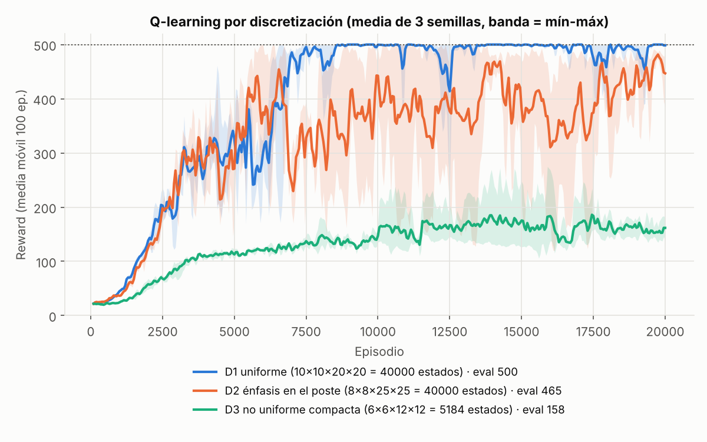
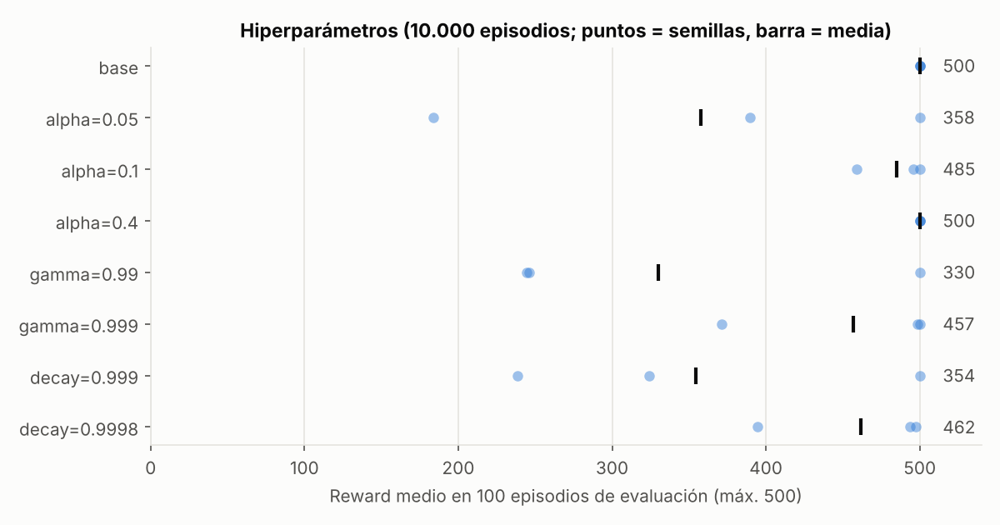
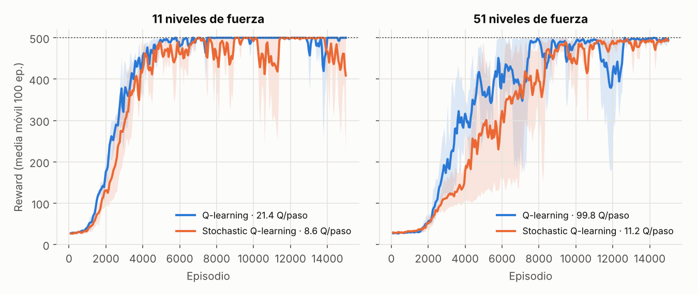
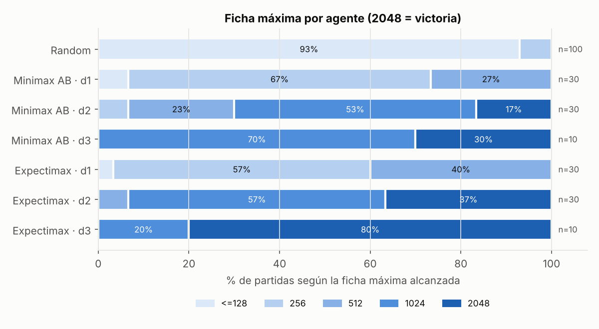
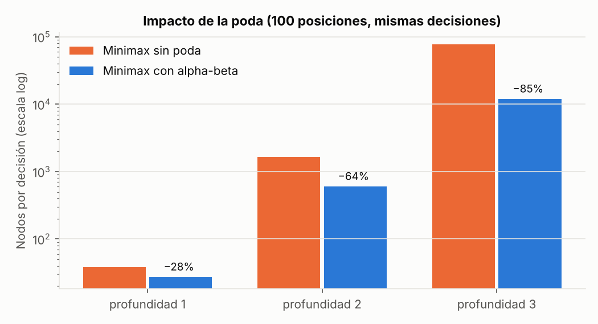
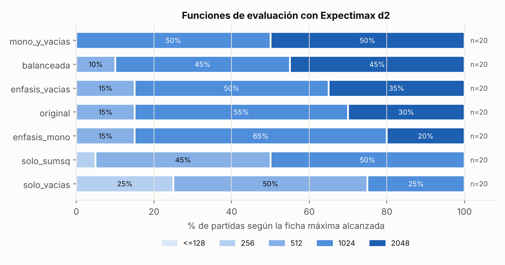
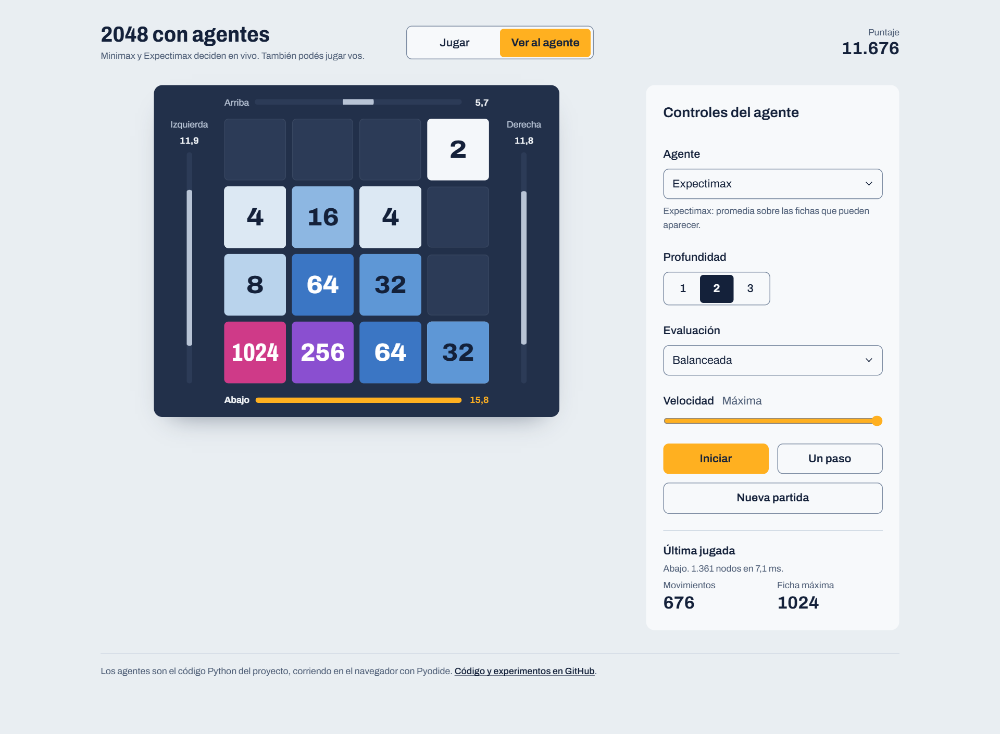

# Agentes de IA: CartPole con Q-learning y 2048 con Minimax/Expectimax

Proyecto personal sobre agentes que aprenden y agentes que planifican. Empezó como un trabajo de un curso de
Inteligencia Artificial que hice solo en 2025. Meses después lo retomé: leí más sobre el tema, revisé la primera versión
a fondo, corregí sus errores y lo usé como base para un proyecto bastante más grande. Tiene dos partes independientes:

| Parte | Problema | Técnicas | Resultado principal |
|---|---|---|---|
| [`cartpole/`](cartpole) | Mantener un poste vertical sobre un carro (Gymnasium `CartPole-v1`) | Q-learning tabular, 3 discretizaciones, búsqueda de hiperparámetros, **Stochastic Q-learning** (Fourati et al., ICML 2024) | 500/500 pasos en los 100 episodios de evaluación, en las 3 semillas |
| [`game2048/`](game2048) | Jugar 2048 | Minimax con poda alpha-beta, Expectimax, 7 funciones de evaluación | Expectimax a profundidad 3 gana el 80% de las partidas; la poda reduce 85% los nodos sin cambiar decisiones |

Los agentes de 2048 también se pueden ver jugando en el navegador, con el valor que calculan para cada jugada:
**[gonzalo-soba.github.io/cartpole-2048-ai-agents](https://gonzalo-soba.github.io/cartpole-2048-ai-agents/)**
(detalles en [La web](#la-web-jugar-o-ver-jugar-al-agente)).

Todos los números de este README salen de los JSON en `*/results/` y se pueden regenerar con los scripts de cada carpeta.
Cada experimento usa semillas fijas.

---

## CartPole: Q-learning y Stochastic Q-learning

### Discretización del estado

Las 4 variables continuas (posición y velocidad del carro, ángulo y velocidad angular del poste) se recortan a un rango
y se dividen en intervalos. Se probaron tres grillas con la misma configuración (α=0.2, γ=0.9995, ε de 1 a 0.001 con
decaimiento 0.9995 por episodio, 20.000 episodios, 3 semillas):

| | Bins | Estados | Reward en evaluación (máx. 500) | Episodios completos |
|---|---|---|---|---|
| **D1** uniforme | 10 × 10 × 20 × 20 | 40.000 | **500.0** | 100% |
| D2 más resolución en el poste | 8 × 8 × 25 × 25 | 40.000 | 464.6 | 79% |
| D3 no uniforme, compacta | 6 × 6 × 12 × 12 | 5.184 | 158.3 | 0% |



D3 tiene 8 veces menos estados pero se estanca cerca de 160. La hipótesis más probable es que 6 intervalos para la
posición y velocidad del carro no alcanzan para detectar que el carro se está yendo del borde. D2, que también le quita
resolución al carro, llega a 500 en algunos tramos pero es más inestable que D1.

### Hiperparámetros

Un parámetro por vez respecto de la base, con 10.000 episodios y 3 semillas. La base y α=0.4 llegan a 500 en todas las
semillas. Con γ=0.99 el horizonte efectivo (~100 pasos) es corto frente a episodios de 500, y un decaimiento de ε
rápido (0.999) deja de explorar antes de tiempo; en ambos casos una semilla llega a 500 y las otras no. α=0.05 aprende
más lento y en 2 de 3 semillas no converge en 10.000 episodios. Con decaimiento 0.9998 el límite es el presupuesto: al terminar, ε
todavía vale 0.13.



### Stochastic Q-learning

El paper propone reemplazar `max` y `argmax` sobre las *n* acciones por `stoch max`: el máximo sobre ⌈ln n⌉ acciones
sorteadas más las 2 últimas acciones explotadas en ese estado. Así el costo por paso pasa de O(n) a O(log n).
CartPole tiene solo 2 acciones, así que se discretizó la **fuerza** en 11 y 51 niveles entre −10 y 10 N
(`cartpole_rl/envs.py`).

| Acciones | Algoritmo | Reward en evaluación | Valores Q consultados por paso | Coincide con el max exacto |
|---|---|---|---|---|
| 11 | Q-learning | 500.0 | 21.4 | |
| 11 | Stochastic Q-learning | 390.3 (500 / 173 / 498 por semilla) | 8.6 | 99.0% |
| 51 | Q-learning | 495.6 | 99.8 | |
| 51 | Stochastic Q-learning | 492.8 | **11.2 (9 veces menos)** | 99.0% |



Con 51 acciones el método llega al mismo nivel consultando 9 veces menos valores Q, y en el 99% de las
actualizaciones `stoch max` coincide con el máximo exacto, gracias a la memoria. Aprende algo más lento al principio. Una
salvedad honesta: en este código el tiempo real por paso es *mayor* (≈48 µs contra ≈26 µs), porque `np.argmax` sobre 51
números es una sola instrucción vectorizada y el sorteo en Python cuesta más. La ventaja en tiempo aparece cuando evaluar
Q es caro (una red neuronal) o cuando hay miles de acciones, que es el caso del paper.

---

## 2048: Minimax y Expectimax

### Motor

El tablero se representa como un entero de 64 bits (16 celdas de 4 bits con el exponente de cada ficha). Cada
movimiento es una consulta a una tabla precomputada de 65.536 filas, y la función de evaluación también se calcula con
tablas por fila. Esto permite explorar alrededor de 400.000 nodos por segundo en Python puro y hace viable la
profundidad 3. Los tests comparan el motor contra una implementación directa de las reglas.

### Agentes y profundidad

*Profundidad* = jugadas propias que mira el agente (d2: MAX → azar → MAX → azar → evaluación). Partidas hasta ganar
(ficha 2048) o perder, con las mismas semillas para todos los agentes.

| Agente | Partidas | Victorias (IC 95%) | Puntaje medio | ms por jugada |
|---|---|---|---|---|
| Random | 100 | 0% | 1.089 | 0.03 |
| Minimax AB d2 | 30 | 17% (7-34%) | 14.024 | 1.8 |
| Minimax AB d3 | 10 | 30% (11-60%) | 16.504 | 37 |
| Expectimax d2 | 30 | 37% (22-54%) | 18.032 | 5.5 |
| **Expectimax d3** | 10 | **80% (49-94%)** | 19.758 | 88 |



Expectimax supera a Minimax a igual profundidad porque modela la aparición de fichas como lo que es, un evento al azar
(celda uniforme, 2 con prob. 0.9 y 4 con 0.1). Minimax supone que siempre aparece la peor ficha en la peor celda y por
eso juega a la defensiva. Expectimax d3 usa poda por probabilidad: no expande ramas con probabilidad acumulada < 0.001.

### Impacto de la poda alpha-beta

Sobre las mismas 100 posiciones de medio juego:

| Profundidad | Nodos sin poda | Nodos con poda | Reducción | Aceleración | Mismas decisiones |
|---|---|---|---|---|---|
| 1 | 38 | 27 | 28% | ×1.1 | sí |
| 2 | 1.662 | 602 | 64% | ×2.8 | sí |
| 3 | 77.888 | 11.982 | 85% | ×5.9 | sí |

Además, 5 partidas completas jugadas con y sin poda son idénticas jugada por jugada. Hay un test
(`tests/test_agents.py`) que verifica que los valores coinciden exactamente.



### Funciones de evaluación

La utilidad es una suma ponderada de suavidad, celdas vacías, monotonicidad, ficha máxima, Σ ficha² y ficha máxima en
esquina (`game2048/heuristics.py`). Con Expectimax d2 y 20 partidas por configuración:



- Ninguna componente sola alcanza: solo celdas vacías o solo Σ ficha² nunca llegan a 2048.
- Los pesos de la primera versión (con Σ ficha² × 0.01) ganaron 30%. Ese término crece con el cuadrado de las fichas y
  termina tapando a las demás componentes. Sin él (*balanceada*) se ganó el 45%.
- Las cuatro mejores combinaciones (30% a 50%) no se pueden separar con 20 partidas: los intervalos de confianza se
  solapan. Para ordenarlas harían falta varios cientos de partidas.

---

## La web: jugar o ver jugar al agente

[](https://gonzalo-soba.github.io/cartpole-2048-ai-agents/)

En [la web](https://gonzalo-soba.github.io/cartpole-2048-ai-agents/) se puede jugar con el teclado (flechas o WASD) o
deslizando en el celular, o elegir un agente (Aleatorio, Minimax con poda, Expectimax), la profundidad y la función de
evaluación, y mirarlo jugar. Alrededor del tablero, cada lado muestra el valor que el agente calculó para esa dirección;
la jugada elegida va en ámbar y las ilegales quedan vacías. En modo Jugar se puede pedir una pista con la misma vista.

Cómo está hecha (`web/`, Vite + React + TypeScript, sin backend):

- **El motor para jugar y animar es TypeScript**, pero tiene que dar exactamente lo mismo que `game2048/board.py`.
  `web/scripts/export_fixtures.py` exporta 212 casos desde Python (tableros aleatorios, de partidas reales y casos
  borde) y los tests de Vitest los comparan uno por uno.
- **Los agentes no están reescritos**: un Web Worker carga [Pyodide](https://pyodide.org/) y ejecuta los mismos `.py`
  de `game2048/game2048/`. Cada jugada llama a `analyze()`, que devuelve el valor exacto de cada dirección, la elegida,
  los nodos explorados y el tiempo. Pyodide se descarga en segundo plano, cuando la página ya está lista.
- Expectimax a profundidad 3 usa la misma poda por probabilidad que los experimentos (`min_prob = 1e-3`).
- Cada push a `main` se publica en GitHub Pages con GitHub Actions.

---

## Qué cambió respecto de la primera versión

La primera versión, de diciembre de 2025, tenía problemas que encontré al retomar el proyecto:

1. **"Stochastic Q-learning" era SARSA.** La actualización usaba `Q(s', a')` con la acción elegida por la política, no
   `stoch max`. Ahora implementa el Algoritmo 1 del paper, con memoria, y se evalúa con espacios de 11 y 51 acciones.
2. **El Minimax no minimizaba.** El nodo "min" promediaba como Expectimax, así que la comparación entre técnicas no
   comparaba nada y la poda alpha-beta sobre un promedio no era válida. Ahora el nodo MIN toma el mínimo y la poda está
   verificada con tests.
3. **Los nodos de azar solo miraban las primeras 4 o 6 celdas vacías**, siempre las de arriba a la izquierda. Ahora se
   expanden todas.
4. **Bootstrap en estados terminales.** El Q-learning sumaba `γ·max Q(s')` incluso cuando el poste ya se había caído.
5. **Resultados de 2048 perdidos.** `json.dump` fallaba con `numpy.int64` y el archivo de resultados quedó cortado.
6. **Reproducibilidad.** No había semillas y cada configuración se corría una sola vez. Ahora todo usa semillas fijas y
   3 semillas por configuración en CartPole.

Con 3 semillas y el bootstrap corregido, la conclusión sobre discretizaciones cambió: en la primera versión D2 parecía
mejor (499 contra 481), con una sola corrida.

---

## Estructura

```
cartpole/
  cartpole_rl/          discretización, ambiente con fuerza discretizada, Q-learning y Stochastic Q-learning
  experiments/          run_experiments.py: suites discretization, hyperparams y actions
  models/               tablas Q entrenadas (.pkl)
  results/              resúmenes por suite (JSON) y runs/ con cada corrida
  figures/  notebooks/  make_figures.py  play.py
game2048/
  game2048/             board.py (bitboard), heuristics.py, agents.py, game.py
  tests/                motor vs. implementación de referencia, alpha-beta == minimax
  results/  figures/  notebooks/  experiments.py  make_figures.py  play.py
web/
  src/motor/            motor de 2048 en TypeScript y fixtures exportados desde Python
  src/agentes/          Web Worker con Pyodide que corre los agentes de game2048/
  src/components/       tablero, brújula de decisión y paneles
  scripts/              export_fixtures.py
```

## Cómo correrlo

Cada parte tiene su propio entorno con [Poetry](https://python-poetry.org/) (Python 3.10 a 3.13).

```bash
# CartPole
cd cartpole
poetry install
poetry run python play.py                                   # evalúa el mejor modelo guardado
poetry run python -m experiments.run_experiments --suite all   # reentrena todo (~1 h 15 min en 2 núcleos)
poetry run python make_figures.py

# 2048
cd game2048
poetry install
poetry run pytest
poetry run python play.py --agent expectimax --depth 2      # ver una partida en consola
poetry run python experiments.py --suite all                # ~40 min en 2 núcleos
poetry run python make_figures.py

# Web (Node 24)
cd web
npm ci
npm run dev                                                 # http://localhost:5173/cartpole-2048-ai-agents/
npm test && npm run lint && npm run build
cd ../game2048 && poetry run python ../web/scripts/export_fixtures.py   # regenera los fixtures del motor
```

Los notebooks de `*/notebooks/` resumen los resultados y cargan los modelos guardados.

## Limitaciones

- Las tasas de victoria en 2048 se basan en 10 a 30 partidas por agente. Los intervalos de confianza son anchos, y las
  diferencias entre heurísticas parecidas no son concluyentes.
- Los tiempos se midieron en un contenedor de 2 núcleos con otros procesos corriendo en paralelo. Las cantidades de nodos
  y de valores Q consultados son más confiables que los milisegundos.
- La búsqueda de hiperparámetros varía un parámetro por vez; no explora interacciones entre ellos.

## Referencias

- F. Fourati, V. Aggarwal, M.-S. Alouini. *Stochastic Q-learning for Large Discrete Action Spaces*. ICML 2024.
  [arXiv:2405.10310](https://arxiv.org/abs/2405.10310)
- Ambiente [CartPole-v1](https://gymnasium.farama.org/environments/classic_control/cart_pole/) de Gymnasium.
- La primera versión partía de un tablero de 2048 y un ambiente de ejemplo provistos en el curso. El motor actual los
  reemplaza y mantiene la misma interfaz.

## Licencia

MIT
